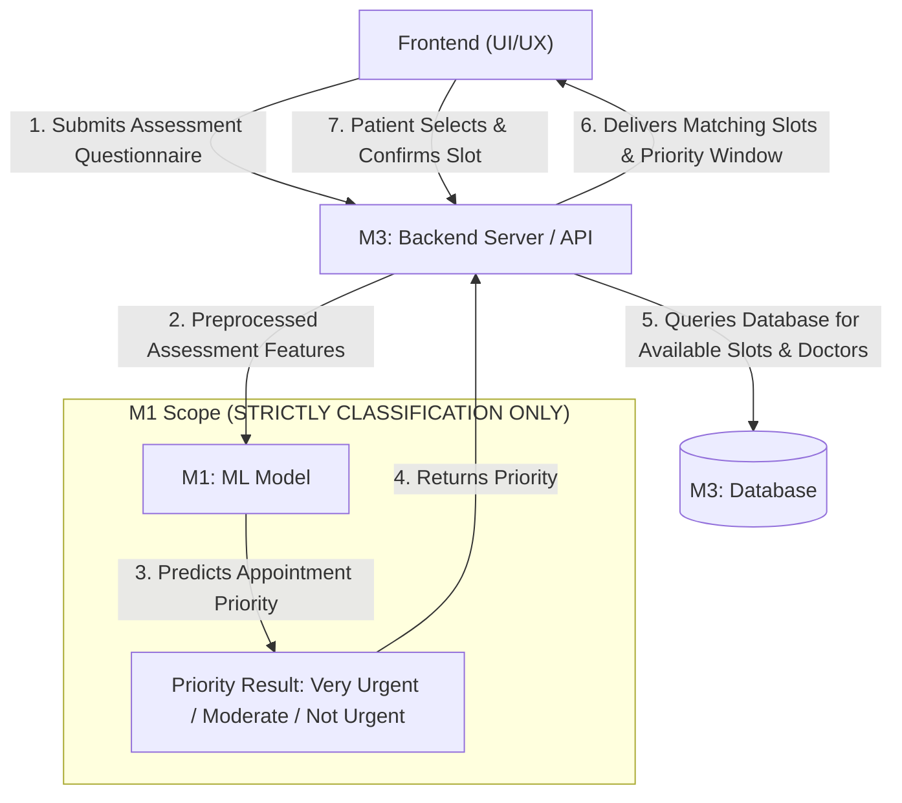

# Smart Doctor — System Integration Specification (M1 & M3)

This document strictly defines the architectural boundaries between:
- **Frontend (UI/UX)**
- **M1 — Machine Learning Department (Appointment Priority Prediction ONLY)**
- **M3 — Backend Department (Database, Scheduling Logic & REST APIs)**

---

## 🏗️ Architecture & Responsibility Separation



---

## 🧠 M1: Machine Learning Department Scope

### Strict Scope:
The ML model is responsible **ONLY** for predicting the patient's appointment priority based on their health assessment answers.

### What the ML Model DOES:
1. Receives the patient's assessment answers.
2. Applies preprocessing/encoding matching the training dataset.
3. Passes features into the trained classification model.
4. Predicts one of the **three appointment-priority categories**:
   - 🔴 **Very Urgent:** High-priority appointment (Recommended window: Today or Tomorrow, subject to doctor availability).
   - 🟠 **Moderate:** Medium-priority appointment (Recommended window: Tomorrow or Later, depending on availability).
   - 🟢 **Not Urgent:** Lower-priority appointment (Recommended window: Later in the week, depending on available slots).
5. Returns the predicted priority to the backend.

### What the ML Model DOES NOT Do:
- Does NOT decide which doctor is available.
- Does NOT decide the exact appointment date or time.
- Does NOT decide whether a doctor is free.
- Does NOT handle patient or doctor login.
- Does NOT interact with the database.
- Does NOT handle appointment confirmation or frontend UI.

---

## 📥 M1 Data Contracts (Synchronized with M1 GitHub Repository)

**M1 Repository:** `https://github.com/Ishikasingh2906/smart-doctor.git`  
**Location in Project:** `m1-model/`  
**Dataset:** `m1-model/data/medical_symptom_triage.csv`  
**Features Definition:** `m1-model/src/config.py`

### 1. Input Features to ML Model:
The model accepts strictly **6 features**:
```json
{
  "age": 45,
  "gender": "Female",
  "comorbidities": "Hypertension",
  "symptom_1": "fever",
  "symptom_2": "stomach pain",
  "symptom_3": "weakness"
}
```

#### Permitted Feature Values:
- **`age`**: Integer (1 – 120)
- **`gender`**: `"Female"` | `"Male"`
- **`comorbidities`**: `"None"` | `"Hypertension"` | `"Diabetes"` | `"Diabetes, Hypertension"` | `"Heart Disease"` | `"Asthma"`
- **`symptom_1`**: `"breathing difficulty"` | `"cough"` | `"fever"` | `"headache"` | `"high fever"` | `"thirst"`
- **`symptom_2`**: `"body pain"` | `"chills"` | `"dizziness"` | `"dry cough"` | `"fatigue"` | `"joint pain"` | `"nausea"` | `"runny nose"` | `"stomach pain"` | `"wheezing"`
- **`symptom_3`**: `"blurred vision"` | `"chest tightness"` | `"cough"` | `"frequent urination"` | `"headache"` | `"light sensitivity"` | `"loss of taste"` | `"sneezing"` | `"sweating"` | `"weakness"`

### 2. Output from ML Model:
The model classifies into one of 3 urgency classes:
```json
{
  "urgency": "High",
  "priority": "Very Urgent",
  "code": 2
}
```
Mapped categories:
- **`High` / `Very Urgent`**: Consultation today or tomorrow.
- **`Medium` / `Moderate`**: Consultation tomorrow or later.
- **`Low` / `Not Urgent`**: Consultation later in the week.

---

## 🗄️ M3: Backend Department Scope (Database & Business Logic)

### Responsibilities:
1. **Database Management:**
   - `patients` (Accounts, demographics, contact info)
   - `doctors` (Profiles, departments, qualifications, experience)
   - `schedules` & `slots` (Real-time availability, booked vs free slots)
   - `appointments` (Patient ID, Doctor ID, Date, Time, ML Priority, Status)
2. **Scheduling Engine:**
   - Takes M1's predicted priority (e.g., `Very Urgent`) and queries the database for available doctors and matching slots (e.g., Today/Tomorrow for Very Urgent).
3. **REST API Endpoints:**

| Method | Endpoint | Description |
|---|---|---|
| `POST` | `/api/auth/login` | Patient/Doctor authentication |
| `POST` | `/api/auth/register` | Patient registration |
| `POST` | `/api/triage/predict` | Forwards assessment to M1 model & returns priority |
| `GET` | `/api/doctors` | List doctors, filtered by specialty or priority |
| `GET` | `/api/doctors/:id/slots` | Available slots for a specific doctor & date range |
| `POST` | `/api/appointments` | Persist confirmed appointment |
| `GET` | `/api/patient/appointments` | Patient appointment history |
| `GET` | `/api/doctor/appointments` | Doctor schedule & today's queue |
| `PATCH` | `/api/appointments/:id` | Status updates (`Completed`, `Cancelled`) |

---

## 💻 Frontend Implementation in `js/app.js`

The frontend (`M1_ML_Service`) strictly requests priority classification from M1:
- Submits structured assessment answers.
- Receives `{ priority: "Very Urgent" | "Moderate" | "Not Urgent", recommended_window: "..." }`.
- Navigates the patient through the Priority Result screen, Doctor Selection, and Slot Selection based on available schedules managed by M3's backend.
